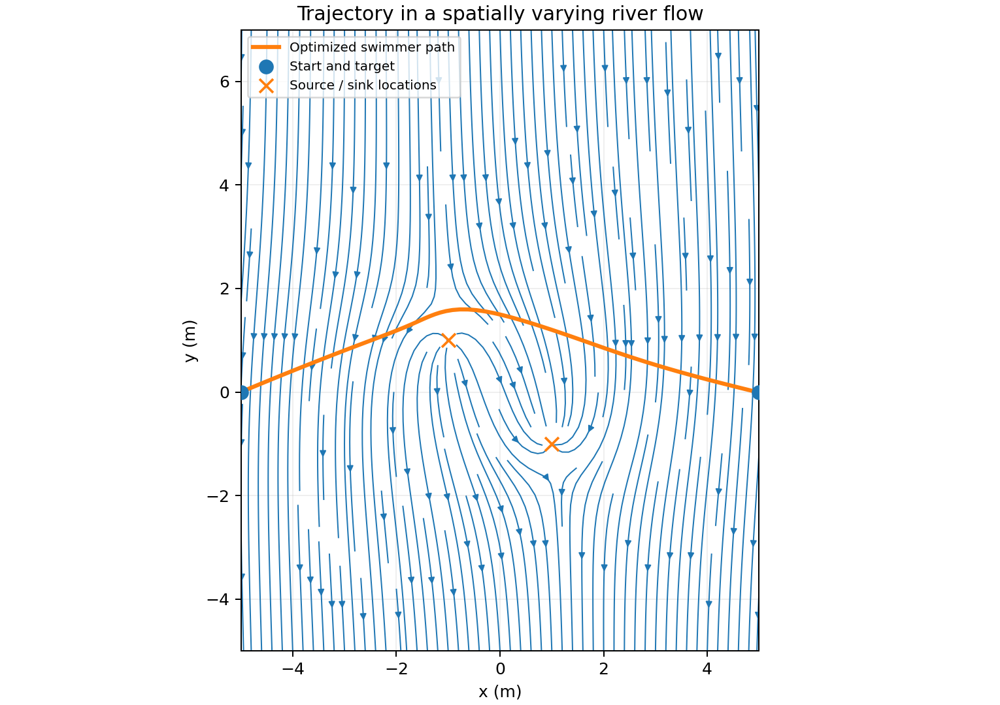
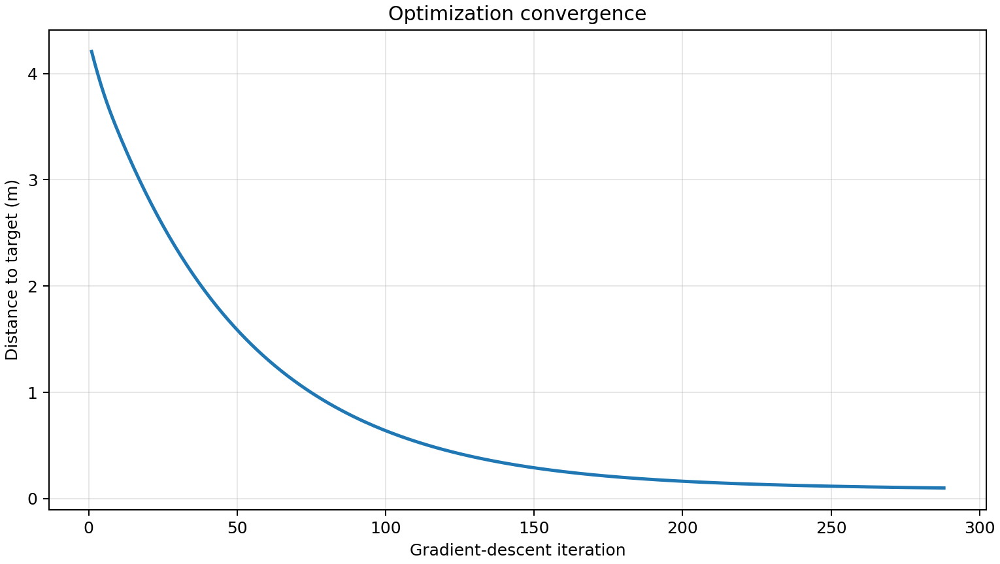

# River-Crossing Path Planning with Numerical Optimization

A small computational project exploring how a swimmer can reach a target on the opposite bank while being carried by a river current. The project combines a kinematic model, numerical time-stepping, finite-difference derivatives and gradient descent to optimize the swimmer's heading.

The research is organized around 3 cases: uniform river speed with constant swimmer propulsive speed, uniform river speed with swimmer fatigue, expressed by exponential decreasing propulsive speed and non-uniform spatially distributed river flow with constant swimming propulsive speed. 

## Demo preview

A demo is included, particularly for case 3. The approach optimizes a sequence of swimming angles for a spatially varying flow field. In the default run, the endpoint is brought within approximately **0.1 m** of the target.





The third plot, which compares the swimmer's selected heading with the resulting ground-velocity direction, is saved as `heading-vs-ground-velocity.png` when the demo is run with `--save-dir`.

## Jupyter walkthrough

The notebook [`notebooks/Nonuniform_Flow_Methodology.ipynb`](notebooks/Nonuniform_Flow_Methodology.ipynb) provides an executable, step-by-step explanation of Case 3. It covers the vector flow field, the swimmer's combined ground velocity, forward-Euler time stepping, the endpoint-error objective, central finite differences scheme, gradient descent and the resulting plots. The notebook is self-contained and can be run from top to bottom.

To open it locally, install Jupyter if needed and launch Notebook or JupyterLab:

```bash
python -m pip install jupyter
jupyter notebook notebooks/Nonuniform_Flow_Methodology.ipynb
```

## Cases covered by the project

| Case | Model | Repository status |
|---|---|---|
| 1 | Uniform downstream current; constant swimmer speed and a constant heading angle | Placeholder only; add the corresponding existing implementation |
| 2 | Uniform downstream current; swimmer speed decreases exponentially to model fatigue | Placeholder only; add the corresponding existing implementation |
| 3 | Spatially varying river current; constant swimmer speed and time-varying heading | Runnable demo included as `demo.py` |

The full report is included at [`docs/Simple_Path_Planning_Report.pdf`](docs/Simple_Path_Planning_Report.pdf).

## Quick start

### 1. Requirements

- Python 3.10 or newer
- NumPy
- Matplotlib

### 2. Create an environment and install dependencies

```bash
python -m venv .venv
```

Activate it, then install the requirements:

**macOS / Linux**

```bash
source .venv/bin/activate
python -m pip install -r requirements.txt
```

**Windows PowerShell**

```powershell
.venv\Scripts\Activate.ps1
python -m pip install -r requirements.txt
```

### 3. Run the demo

```bash
python demo.py
```

This runs the optimizer and opens 3 matplotlib figures: the convergence history, the optimized path over the flow field and the swimmer-heading versus ground-velocity directions.

To save the figures and run without opening windows (useful on a remote machine or in a notebook environment):

```bash
python demo.py --save-dir outputs --no-show
```

The script prints the final position, target, endpoint error, iteration count and whether the requested tolerance was reached. A non-zero exit status indicates that the maximum iteration count was reached before satisfying the tolerance (so the target was not reached in time).

## Try different parameters

`demo.py --help` lists all options. For example:

```bash
python demo.py --learning-rate 0.005 --max-iterations 400 --save-dir outputs
```

Useful options include:

| Option | Default | Meaning |
|---|---:|---|
| `--width` | `10` | River width, in metres |
| `--target-y` | `0` | Target's vertical coordinate, in metres |
| `--swimmer-speed` | `1` | Swimmer's speed relative to the water, in m/s |
| `--downstream-speed` | `0.5` | Uniform downstream component, in m/s |
| `--source-strength` | `2` | Strength parameter for the source/sink pair |
| `--total-time` | `12.7` | Fixed time horizon, in seconds |
| `--steps` | `100` | Number of discrete heading controls |
| `--learning-rate` | `0.01` | Gradient-descent learning rate |
| `--initial-angle` | `0.87` | Initial heading for each time step, in radians |
| `--tolerance` | `0.1` | Target distance at which optimization stops, in metres |
| `--max-iterations` | `400` | Maximum optimizer iterations |
| `--save-dir` | not set | Directory for the PNG plots |
| `--no-show` | off | Save requested plots and do not open figure windows |

Different parameter combinations can change how quickly the optimizer converges. Gradient descent is sensitive to initialization and learning rate, and the script reports when the requested tolerance is not reached within the maximum iterations.

## Model and numerical method

The swimmer starts at

$(x_0,y_0)=\left(-\frac{D}{2},0\right)$

and aims for the target

$(x_t,y_t)=\left(\frac{D}{2},y_t\right).$

At each time step, the total velocity is the vector sum of the swimmer's constant-magnitude relative velocity and the local river-flow velocity:

$\mathbf{u}_{\mathrm{total}}=\begin{bmatrix}u_m\cos\theta_k+f_x(x_k,y_k)\\u_m\sin\theta_k+f_y(x_k,y_k)\end{bmatrix}.$

The path is advanced with an explicit finite-difference (forward Euler) update:

$
\mathbf{r}_{k+1}=\mathbf{r}_k+\Delta t\,\mathbf{u}_{\mathrm{total},k}.
$

The control variable is the sequence of heading angles \(\boldsymbol{\theta}=[\theta_0,\ldots,\theta_{N-1}]\). The optimizer minimizes the squared endpoint error

$
J(\boldsymbol{\theta})=(x_N-x_t)^2+(y_N-y_t)^2.
$

Each gradient component is estimated with a central finite difference, and the angle sequence is updated by gradient descent. NumPy batches the perturbed simulations to make this computation faster while preserving the central-difference calculation.

The demo's flow field consists of a source/sink pair superimposed on a uniform downstream current, following the flow expression in Section 2.3 of the report. A small denominator floor avoids division by zero if a simulated point lands exactly on a source or sink; the idealized point-flow model is singular at those points.

## A note about the supplied script and report

The original uploaded program is preserved without edits at [`original/Path_Planning_Nonuniform.py`](original/Path_Planning_Nonuniform.py). The runnable `demo.py` is a documented adaptation of the **non-uniform-flow case only**.

Two inconsistencies in the supplied material are worth noting:

1. The uploaded script sets `ytarget = 0`, while Table 3 of the report lists `yt = 5 m` for its non-uniform-flow examples. The demo defaults to `0 m` to match the uploaded script and its reproducible default run. The target can be changed with `--target-y`.
2. In the uploaded script, `R1` and `R2` are assigned squared distances and then squared again in the flow denominator. Section 2.3 of the report defines `R1` and `R2` as distances and uses their squares in the denominator. The demo follows the report's stated equation by using squared distances directly in the denominator. The original script is retained for transparency rather than being overwritten.

These choices are documented so the original code, report and runnable demo can be compared deliberately.

## Repository layout

```text
river-crossing-trajectory-optimization/
├── README.md
├── requirements.txt
├── demo.py
├── notebooks/
│   └── Nonuniform_Flow_Methodology.ipynb
├── original/
│   └── Path_Planning_Nonuniform.py
├── docs/
│   ├── Simple_Path_Planning_Report.pdf
│   ├── convergence.png
│   ├── heading-vs-ground-velocity.png
│   └── nonuniform-flow-path.png
└── cases/
    ├── uniform_flow_constant_speed/
    │   └── README.md
    └── uniform_flow_exponential_fatigue/
        └── README.md
```

The two case folders contain documentation placeholders only—no new Python code has been written for those scenarios. Add your existing scripts to those folders when you assemble the complete repository.

## Suggested GitHub setup

1. On GitHub, create a new empty repository named `river-crossing-trajectory-optimization` (do not initialize it with another README, since this folder already includes one).
2. From this project folder, run:

   ```bash
   git init
   git add .
   git commit -m "Add river-crossing path-planning project"
   git branch -M main
   git remote add origin https://github.com/YOUR_USERNAME/river-crossing-trajectory-optimization.git
   git push -u origin main
   ```

   Replace `YOUR_USERNAME` with your GitHub username. When you add the two existing uniform-flow scripts, commit them in their corresponding `cases/` folders.

No open-source license has been selected in this scaffold. Choose and add a license before presenting the repository as reusable open-source software.
